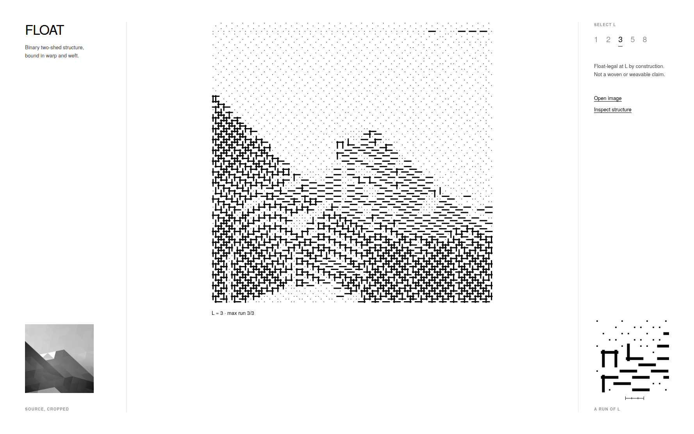

# FLOAT

FLOAT turns an image into a binary two-shed structure whose maximum run length is bounded by `L`, in both the row and column direction, by construction.



## What it does

Give FLOAT an image and a value `L`. It resamples the image into a small grayscale target, then solves for a binary (two-value) grid where no run of same-value cells — horizontal or vertical — exceeds `L` cells long.

It's a structural interpretation instrument, not a general-purpose image converter. It reads best on images with large simple tonal regions and clear boundaries — a silhouette, a horizon line, hard-edged flat fields. Fine detail and busy midtones get absorbed into the bound.

## The bound

`L` is the one control: the maximum number of consecutive same-value cells allowed in a row or column.

- `L = 1` forces strict binary alternation in both directions — a checkerboard. All image information is gone; only the bound itself is visible.
- Larger `L` lets longer runs form, so more tonal structure survives, at the cost of longer runs.
- Rows are solved exactly (dynamic programming over value × run-length; per-row optimal). Columns are enforced by a hard domain restriction during row solving — a column that has reached its limit forces the next cell to flip. The bound is hard and guaranteed; a global two-dimensional error optimum is not claimed.

**Claim ceiling:** *float-legal at L by construction.* Nothing here says a structure is weavable or has been through a loom.

## Run it

Static files, no build step. Start the server one level *above* `interface/` — the page loads `../float-core.js` by relative path.

```bash
cd float-weave/wedge
python3 -m http.server 8000
# open http://127.0.0.1:8000/interface/
```

Default view: the bundled specimen at `L = 3`. `L` is selectable at `{1, 2, 3, 5, 8}`. `Open image` loads your own file, centre-cropped to a square and solved the same way.

Command-line, no browser (requires `numpy` and `Pillow`; no other install, no account, no network):

```bash
cd float-weave/wedge
python3 weave.py <image-path> -L 3 -n 240 -o out/my_run
python3 weave.py pattern:blocks -L 2 -n 240 -o out/blocks_L2   # built-in test patterns
xdg-open out/my_run/view.html
```

## Exports

The CLI writes, per run:

- `preview.png` — the bounded structure rendered as interlacement.
- `lift.png` / `lift.bmp` / `lift.tif` — a 1-bit bitmap, one pixel per grid cell. White = 1, black = 0.
- `lift.wif` — a WIF 1.1 liftplan encoding the same structure as a shaft/pick format. At the sizes this tool produces, the shaft count (`Shafts = n`, commonly in the hundreds) is generally far beyond what physical shaft-loom hardware or software targets.
- `receipt.json` — dimensions, `L`, measured max run per axis, whether any constraint was relaxed, and a sha256 of every other output file.

The browser UI shows the preview and a live measurement; it does not currently export files.

## Verification

- **Solver correctness, 9/9** — three sources × three `L` values, each independently re-measured: max run equals `L` exactly on both axes, zero relaxed constraints.
- **JS/Python parity, 9/9** — the browser and CLI solvers produce bit-identical structures on the same targets.
- **BMP/TIF export parity** — both formats read back to the exact solver output.
- **WIF liftplan** — checked against a small hand-verified test case for correct mapping.
- **Fail-closed** — a solver output that fails re-verification writes only a failure receipt and exits non-zero; covered by an automated test with deliberately invalid inputs.
- **Renderer truth** — every mark the browser renderer draws is derived from the solved grid; strokes are added only for maximal zero-value runs whose length is exactly `L`; one-value cells stay white. Checked across all five selectable `L` values.
- **Frozen artifacts** — the original proof script and its output images are hash-verified unchanged since freeze.

## Limits

- Not a physical weaving claim. Float-legal is necessary information about run length; it says nothing about yarn, tension, sett, or loom behavior.
- Not a jointly optimal 2D solver. Rows are exact; columns are enforced greedily during row solving. Small deviations from a true joint optimum are expected.
- Busy or gradual-gradient images can turn to noise, especially at low `L`.
- Grayscale only, two values, one square structure per run, one bound. No color, no multi-layer weaves, no loom simulation, no threading constraints.

## Structure

```
float-weave/
├── float_proof.py       # frozen proof
├── proof_*.png
├── SHA256SUMS
├── docs/                # static copy of wedge/interface + float-core.js (GitHub Pages); float.png
└── wedge/
    ├── weave.py          # CLI solver + exports
    ├── float-core.js     # browser solver (parity-verified against weave.py)
    ├── test_failclosed.py
    ├── test_parity.py
    └── interface/        # static browser UI
        ├── index.html
        ├── app.js
        ├── limit-trace.js
        └── assets/
```

## License

Code: MIT, see `LICENSE`.
Third-party assets: see `THIRD_PARTY_NOTICES.md`.
